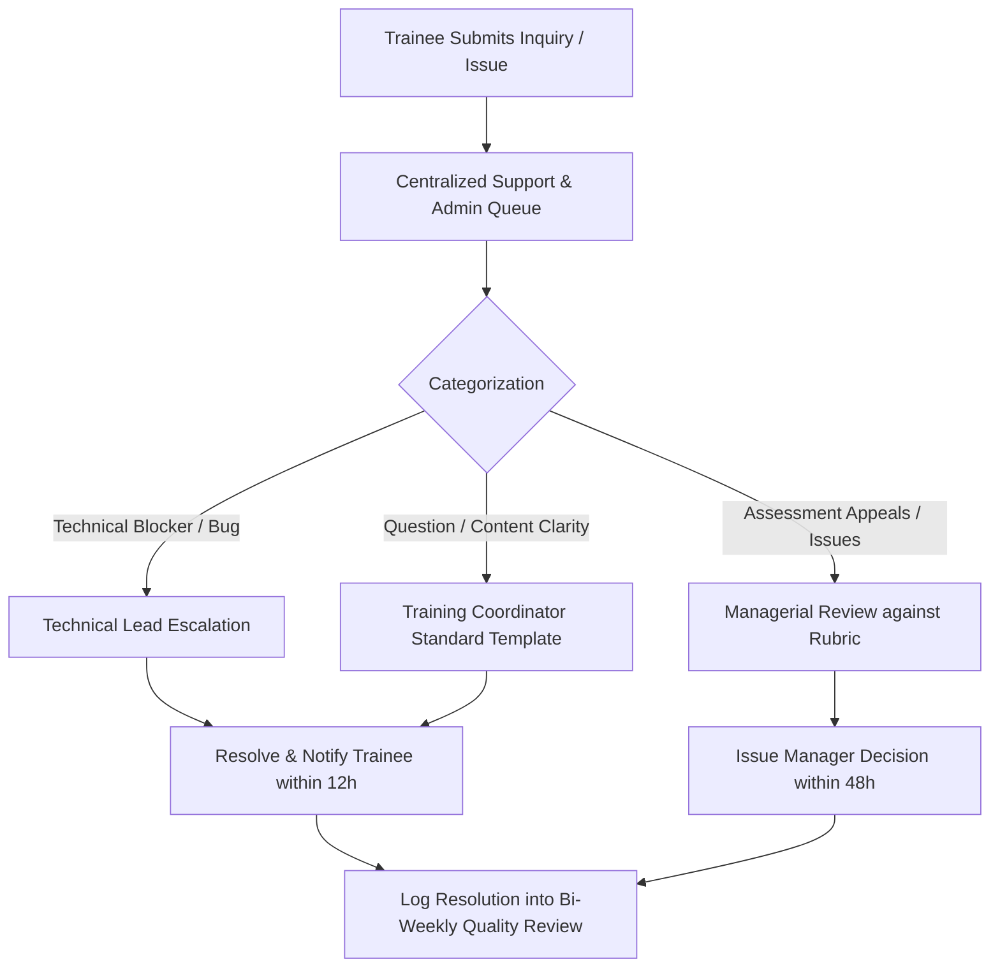

# CRVS Training & Technical Assessment Governance Framework

> **Authority**: Dire Dawa City Administration · Vital Events Registration Agency (CRVS)  
> **Applicability**: Pre & Post Training Assessment for Registrars & Trainees under Proclamation No. 1370/2024  
> **System**: CRVSAFR (CRVS Assessment Suite)

---

## 1. Process Optimization (Friction & Hassle Elimination)

To prevent administrative bottlenecks, repetitive manual inquiries, and logistical friction:
* **Self-Service Onboarding:** Trainees register via Android/iOS/Web app with instant account generation and automated Kebele/Cohort assignment.
* **Automated Scoring & Gatekeeping:** Objective multiple-choice questions are scored automatically upon submission against the 24-point / 50% pass threshold.
* **Single Sign-On & Roster Sync:** Eliminates manual roster compilation; examinee lists are immediately accessible to Administrators and Managers.
* **Zero Score Disclosure to Examinees:** Scores and answer keys remain strictly locked from examinee view to prevent answer sharing across batches, eliminating exam leak disputes.

---

## 2. Trainee Feedback Management & Response SOP

A standardized mechanism to handle trainee submissions, questions, and support requests.

### Response Workflow

### Response Service Level Agreements (SLAs)
* **General Inquiries & Guidance:** Response delivered within **24 hours**.
* **Technical Issues / Login Assistance:** Acknowledged within **2 hours**, resolved within **12 hours**.
* **Assessment Inquiries / Re-take Approvals:** Managerial review completed within **48 hours**.

---

## 3. Follow-Up Analysis & Continuous Improvement Plan

### A. Quantitative Analysis (Automated via Backend Engine)
* **Pre-Test vs. Post-Test Delta:** Measures net knowledge gain across cohorts and Kebeles.
* **Section-by-Section Scoring:**
  * *Section A:* Proclamation 1370/2024 Legal Foundations (8 pts)
  * *Section B:* Digital CRVS Registration Workflows (8 pts)
  * *Section C:* Practical Field Scenarios & Case Handling (6 pts)
  * *Section D:* Ethics & Problem Solving (2 pts)
* **Question Difficulty Index (Item Analysis):** Flags questions where incorrect response rate exceeds 40%, identifying areas requiring curriculum reinforcement.

### B. Qualitative & Content Analysis
* Review of open-ended scenario answers to detect recurring misunderstandings in field protocols.
* Tracking feedback tickets submitted by trainees during and after training.

### C. Reporting Schedule
* **Daily Operational Dashboard:** Active registrations, completion rates, and average submission duration.
* **Post-Cohort Executive Briefing:** Comprehensive summary report for CRVS Directorate leadership with certification issuance rates.

---

## 4. Content & Terminology Clarity Audit

All assessment prompts and training instructions must adhere to the following clarity standards:
* **Bilingual Parity:** Direct alignment between Amharic (አማርኛ) and English terminology without translation ambiguities.
* **Plain Language Guideline:** Replace overly dense legalistic phrasing with clear operational instructions while preserving statutory fidelity.
* **Pilot Verification:** Any new question introduced into the question bank must undergo review by at least two senior CRVS supervisors before deployment.

### Ambiguity Review Register
| Item ID | Original Phrasing | Issue / Ambiguity | Approved Standardized Phrasing |
| :--- | :--- | :--- | :--- |
| **Q-AUD-01** | *"Ensure proper parameter verification"* | Unclear which parameters to check. | *"Confirm that Date, Location, and Declarant ID are verified before saving."* |
| **Q-AUD-02** | *"Submit when requisite data is staged"* | Jargon; confusing to non-technical users. | *"Review entered information and press 'Submit' to complete the assessment."* |

---

## 5. Technical Assessment Checklist

Evaluators and supervisors use this checklist when validating trainee performance during practical software simulations and live field assessments.

| Domain | Evaluation Criteria | Verification Method | Standard Required |
| :--- | :--- | :--- | :--- |
| **1. Access & Security** | Proper login, credential protection, and session logout | Observational check | No shared credentials; secure logout |
| **2. Identity Verification** | Accurate capture of declarant documentation per Proclamation 1370/2024 | Record audit | 100% compliant documentation |
| **3. Vital Event Registration** | Correct event classification (Birth, Death, Marriage, Divorce) | Submission data review | Zero classification errors |
| **4. Mandatory Fields** | Adherence to non-empty validation rules and formatting standards | Database record verification | 0 validation bypass attempts |
| **5. Error Rectification** | Proper handling and resolution of system warning prompts | Scenario observation | Resolution within standard workflow |
| **6. Certificate Readiness** | Attainment of minimum 50% passing threshold (≥ 12/24 points) | Automated scoring engine | Pass threshold satisfied |
